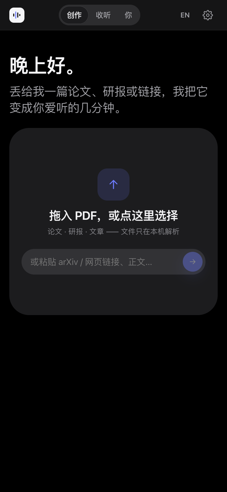
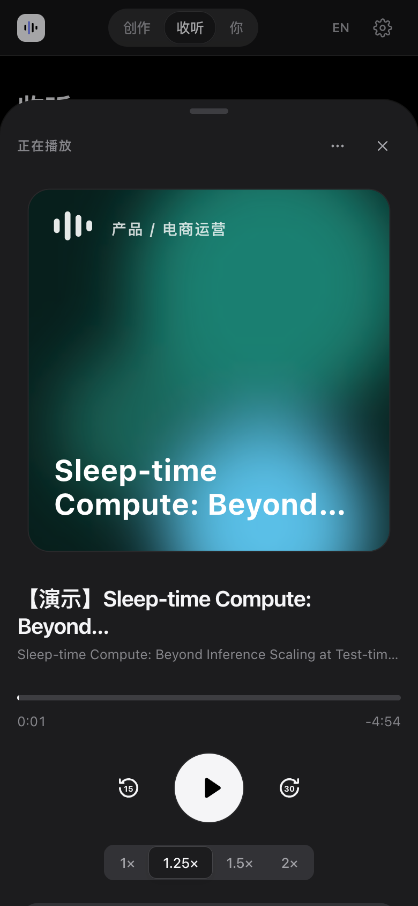
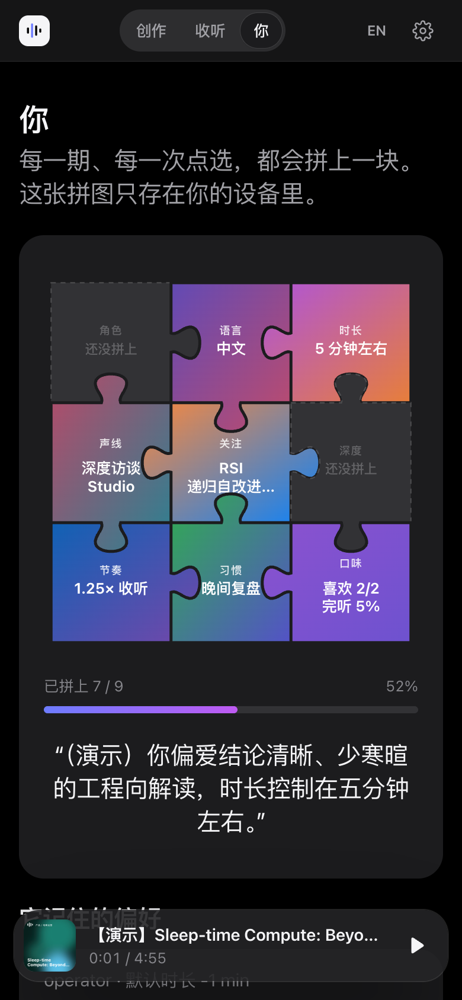
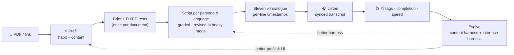

<div align="center">


# Evocast

### AI‑native podcasts that evolve with you.

Drop a 60‑page paper, report or link. Get a sharp **3–8 minute, two‑host episode** in **English or Chinese**, written for *you* — then watch the harness that wrote it **improve itself**.

[](https://github.com/LittleA-Agentic-RL-Harness/evocast/actions/workflows/ci.yml)
[](LICENSE)
[](https://github.com/LittleA-Agentic-RL-Harness/evocast/releases)
[](https://nextjs.org)
[](https://elevenlabs.io)
[](https://www.anthropic.com)

[**Live demo**](https://evocast.vercel.app) · [**Download for Mac**](https://github.com/LittleA-Agentic-RL-Harness/evocast/releases/latest) · [Architecture](docs/ARCHITECTURE.md) · [Research](docs/RESEARCH.md) · [简体中文](README.zh-CN.md)

<br/>


</div>

---

## Why Evocast

Most "paper‑to‑podcast" tools give everyone the same 20‑minute chat. Evocast is built around three ideas:

1. **One source, many listeners.** The same paper becomes a different episode for a researcher, an engineer, an executive, a commerce operator or a newcomer — different depth, jargon budget, structure and takeaways, each checked by persona‑specific tests.
2. **It improves itself — measurably.** The generation *harness* evolves with **HarnessPro** (arXiv [2610.26770](https://arxiv.org/abs/2610.26770)): fixed label‑free tests, cost/balanced/quality planners, Pareto selection → three modes, *lite · medium · heavy*. A second harness evolves the **interface** itself.
3. **It gets to know you.** What's pre‑filled, what's shown, which shortcuts appear — all learned from your choices, replay‑evaluated for free, auto‑reverted if they get worse. Your portrait fills in like a puzzle. It never leaves your device.

| | Evocast | NotebookLM Audio | ElevenLabs GenFM | Podcastfy / open‑notebook |
|---|:-:|:-:|:-:|:-:|
| Open source, self‑host, bring your own keys | ✅ | — | — | ✅ |
| Persona‑specific versions of one source | ✅ 5 personas | prompt only | prompt only | profiles |
| Hard length budget (3–8 min) + coverage tests | ✅ | — | duration scale | — |
| Fact‑checking against fixed, source‑derived tests | ✅ | — | — | — |
| Self‑improving harness (Pareto, lite/medium/heavy) | ✅ | — | — | — |
| Self‑improving interface & prefill | ✅ | — | — | — |
| Chinese + English, code‑switched tech terms | ✅ | ✅ | ✅ | ✅ |
| Synced transcript (per‑line timestamps) | ✅ | — | — | — |
| Voice choice, voice design, cloning | ✅ | — | ✅ | varies |
| Web · installable PWA · native Mac app | ✅ | web | web | web / docker |

## A tour

<table>
<tr>
<td width="50%"><b>Create — one sentence, pre‑filled for you</b><br/>
<picture><source media="(prefers-color-scheme: dark)" srcset="docs/assets/home-recipe-dark.png"></picture></td>
<td width="50%"><b>Listen — your shelf, generative covers</b><br/>
<picture><source media="(prefers-color-scheme: dark)" srcset="docs/assets/listen-dark.png"></picture></td>
</tr>
<tr>
<td><b>Now Playing — transcript synced line by line</b><br/>
<picture><source media="(prefers-color-scheme: dark)" srcset="docs/assets/player-dark.png"></picture></td>
<td><b>You — a portrait that fills in as you listen</b><br/>
<picture><source media="(prefers-color-scheme: dark)" srcset="docs/assets/you-dark.png"></picture></td>
</tr>
<tr>
<td><b>First launch — one greeting, one drop zone</b><br/>
<picture><source media="(prefers-color-scheme: dark)" srcset="docs/assets/home-empty-dark.png"></picture></td>
<td><b>Two keys — detected, verified, newest models picked</b><br/>
<picture><source media="(prefers-color-scheme: dark)" srcset="docs/assets/keys-dark.png"></picture></td>
</tr>
</table>

<p align="center">
&nbsp;
&nbsp;

</p>

<sub>Screenshots are from the built‑in demo mode (no keys, placeholder scripts quoting the source, silent audio) using real arXiv papers.</sub>

## How it works



- **Content harness** — trajectory analyzer → planners (cost / balanced / quality) → whitelisted, schema‑checked edits → evaluation on a fixed validation set with fixed tests → drop below‑floor and Pareto‑dominated versions → pick *lite / medium / heavy* with HarnessPro's weighted squared distance (α,β = 1:2 · 1:1 · 2:1).
- **Interface harness** — every Create logs *what we pre‑filled vs what you chose*. Replaying history scores any prefill policy for free; knobs self‑tune; a planner rewrites prefill rules, shortcuts, disclosure and tone; a live guard reverts any change whose hit rate drops.
- **Progressive disclosure** — first launch shows a greeting and a drop zone. *Listen*, *You*, fine‑tuning and the evolution engine appear as you use the app (or toggle "Show everything").

Deep dive: [docs/ARCHITECTURE.md](docs/ARCHITECTURE.md) · design notes and research: [docs/RESEARCH.md](docs/RESEARCH.md)

## Quick start

**Use it** — open the [live demo](https://evocast.vercel.app), paste two keys (or try demo mode). Install it as an app: Safari → *File → Add to Dock*, or Chrome/Edge → *Install*.

**Deploy your own** — one click, no environment variables needed (everyone brings their own keys):

[](https://vercel.com/new/clone?repository-url=https%3A%2F%2Fgithub.com%2FLittleA-Agentic-RL-Harness%2Fevocast&project-name=evocast&repository-name=evocast)

**Run locally**

```bash
git clone https://github.com/LittleA-Agentic-RL-Harness/evocast && cd evocast
npm install
npm run dev            # http://localhost:3000 — demo mode works without keys
```

**Mac app** — download the `.dmg` from [Releases](https://github.com/LittleA-Agentic-RL-Harness/evocast/releases/latest) (Apple Silicon). It runs the whole app *and its API* locally. Unsigned build: open once, then *System Settings → Privacy & Security → Open Anyway*. Build it yourself with `npm --prefix desktop install && npm run desktop:build`.

**CLI**

```bash
cp .env.example .env.local     # ANTHROPIC_API_KEY + ELEVENLABS_API_KEY
npm run podcast -- --url https://arxiv.org/abs/2610.26770 --persona engineer --lang zh,en --minutes 5
npm run podcast -- --file report.pdf --harness my-evolved-harness.json
```

## The two keys

| Key | What it does | Notes |
|---|---|---|
| **Model** | reads, writes, grades, evolves | Anthropic (default **Claude Opus 5.5**, newest models listed live) or any OpenAI‑compatible API — DeepSeek, Qwen, Kimi, GLM, OpenRouter, Gemini. Detected by key prefix; ambiguous `sk-…` keys ask once. |
| **ElevenLabs** | voices | Reads your plan, quota and models; uses the newest dialogue model (**Eleven v4** today, future `eleven_vN` automatically). Library voices via API need a paid plan. |

Keys stay on your device and are sent per request to stateless routes that forward them to the provider. No telemetry. See [SECURITY.md](SECURITY.md).

## Personas & voices

| Persona | Gets |
|---|---|
| Researcher | novelty vs prior work, method, evaluation, limitations |
| Engineer | architecture, cost/latency trade‑offs, what to try this week |
| Executive / Investor | bottom line in the first 20%, exactly three decisions |
| Product / Commerce Ops | scenarios, metrics, a 3‑step experiment |
| Newcomer | one strong analogy, every term defined |

Two voice packs per language — **Studio Interview** (calm, premium) and **Idol Radio** (sweet, bright) — each seat swappable via ElevenLabs recommendations, Voice Library search, **Voice Design** (describe a voice → 3 previews) or **Instant Voice Cloning**. Optional **Eleven Music** intro sting.

## Roadmap

- [ ] Real sample episodes + an evolution run on the README (in progress)
- [ ] Pluggable TTS providers (OpenAI, Gemini, local Kokoro / CosyVoice)
- [ ] Cross‑family judge model; difficulty routing to lite / medium / heavy
- [ ] Team hub (shared library and harness via Vercel Blob/KV)
- [ ] Topic subscriptions → daily briefing; RSS feed output
- [ ] Signed & notarized macOS build; Windows build
- [ ] `npx evocast` and an MCP server

## Contributing

PRs welcome — see [CONTRIBUTING.md](CONTRIBUTING.md). Good first issues: a new TTS provider, persona, language or evaluation rule.

## Acknowledgements

The self‑improvement loop implements ideas from *HarnessPro: Recursive Harness Self‑Improvement with Pareto Optimization for Performance‑Cost Trade‑offs* (arXiv:2610.26770). Evocast is an independent implementation, not affiliated with the authors. Voices by ElevenLabs. Built by [LittleA](https://github.com/LittleA-Agentic-RL-Harness).

## License

[Apache‑2.0](LICENSE) © 2026 LittleA
