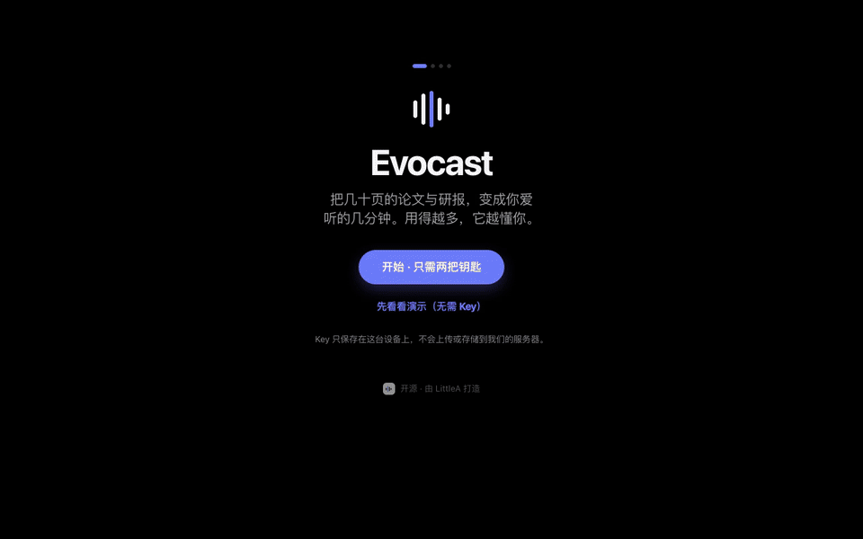
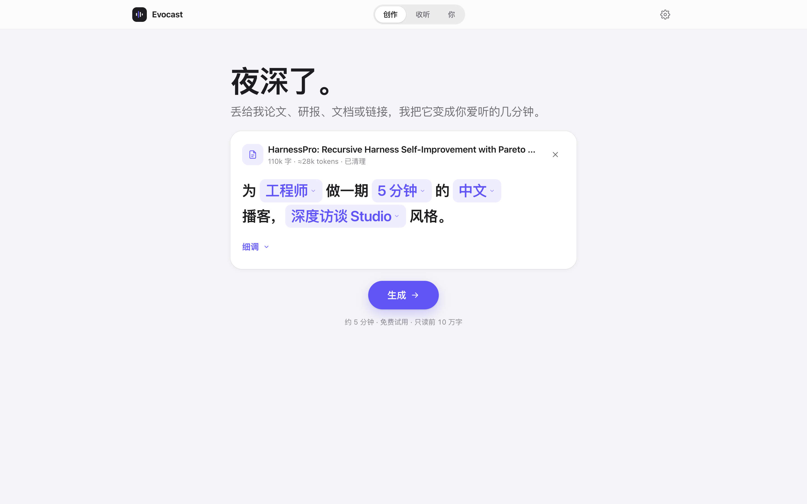
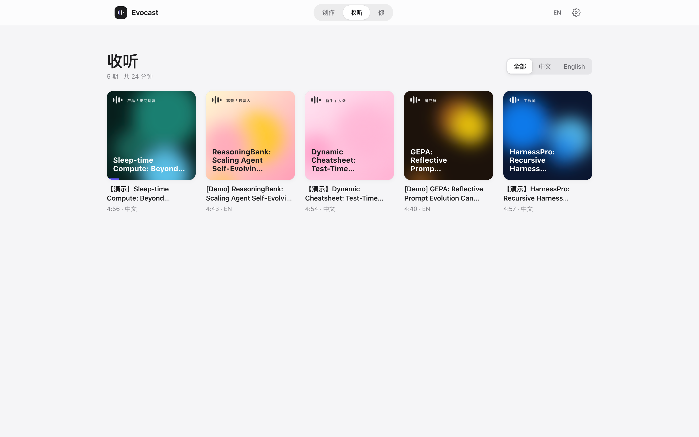
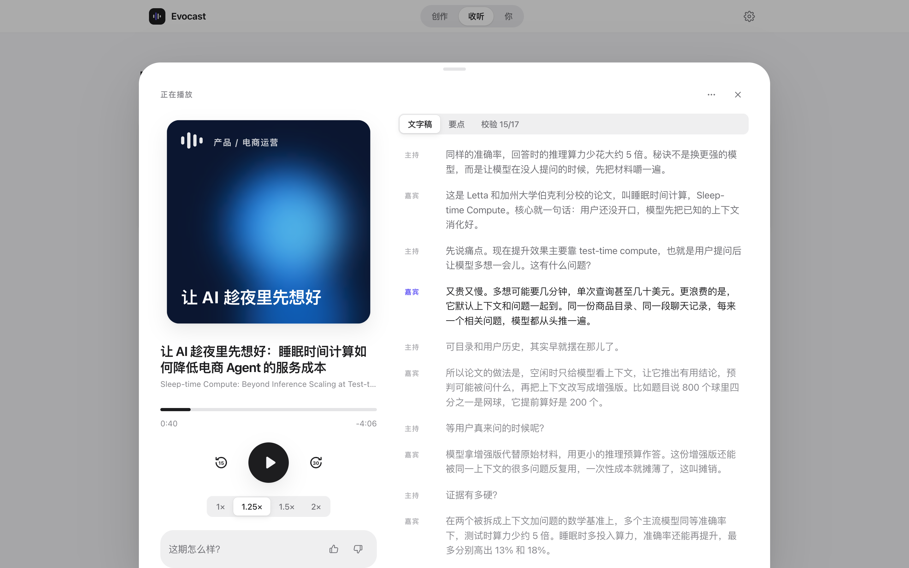
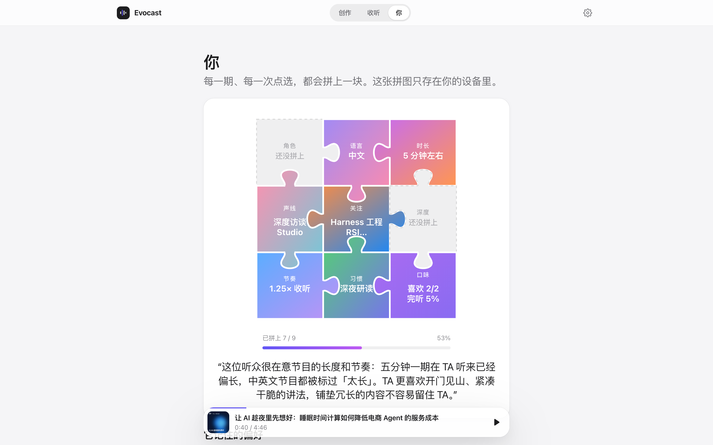
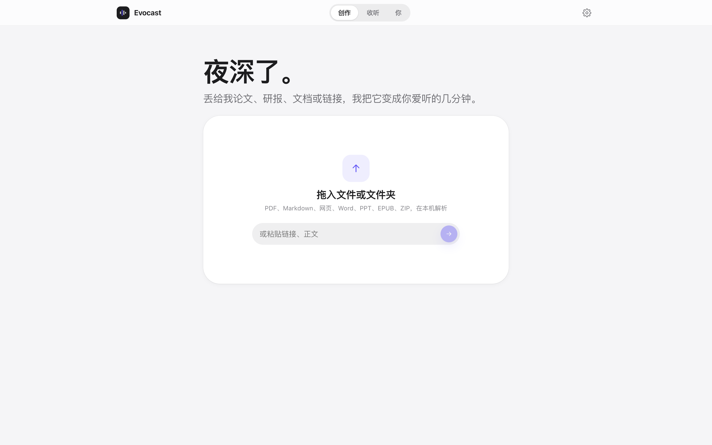
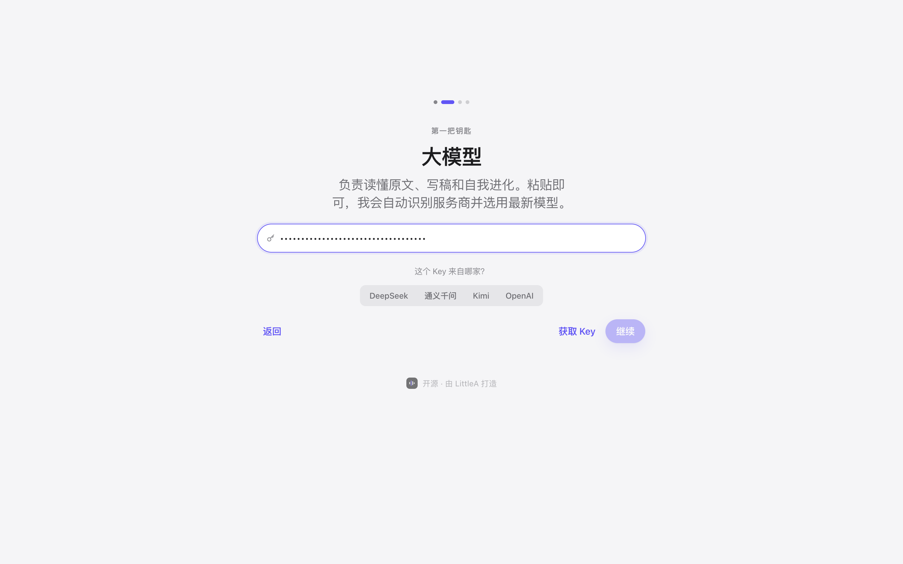
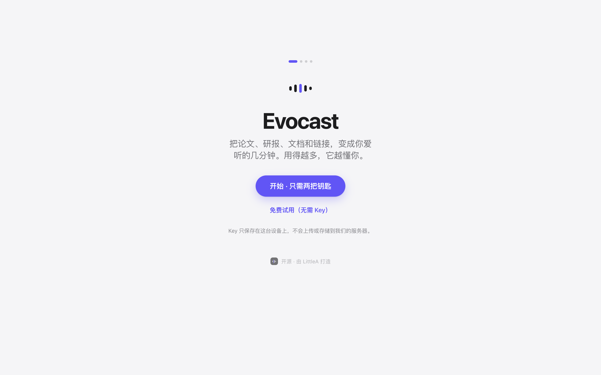
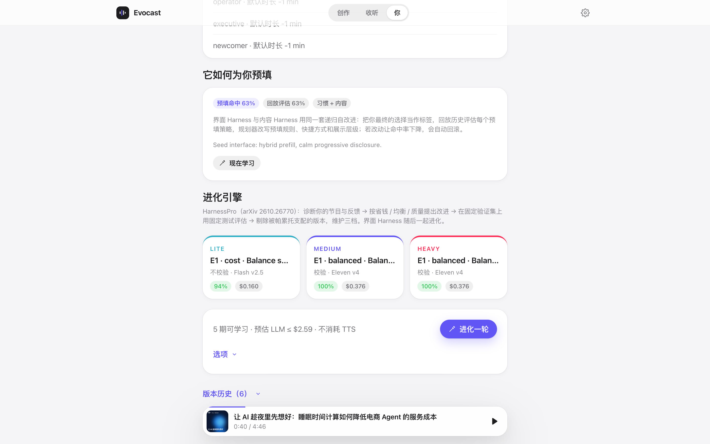
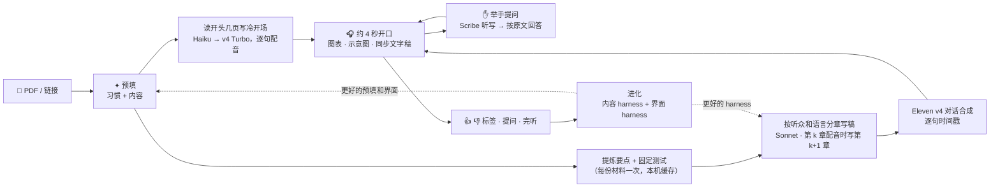

<div align="center">


# Evocast

### 会自我进化的 AI 原生播客

丢给它论文、研报、一整个文件夹的资料或几个链接，它会为**你**写一期 **3–8 分钟的中英双人播客**。写稿用的 harness 还会**自己变得更好**。

[](https://github.com/LittleA-Agentic-RL-Harness/evocast/actions/workflows/ci.yml)
[](LICENSE)
[](https://github.com/LittleA-Agentic-RL-Harness/evocast/releases)

[**免费试用，不需要 Key**](https://evocast.vercel.app) · [**下载 Mac 版**](https://github.com/LittleA-Agentic-RL-Harness/evocast/releases/latest) · [架构](docs/ARCHITECTURE.md) · [运营](docs/OPERATIONS.zh-CN.md) · [调研](docs/RESEARCH.md) · [English](README.md)

<br/>



</div>

---

## 为什么是 Evocast

1. **一篇材料，多个听众版本。** 研究员、工程师、高管/投资人、产品电商运营、新手，各自得到深度、术语、结构和收尾都不同的一期，并用针对每类听众的测试逐条校验。
2. **会自我改进，而且可度量。** 写稿 harness 按 **HarnessPro**（arXiv [2610.26770](https://arxiv.org/abs/2610.26770)）进化：
   - 用固定的无标签测试评估；
   - 分别按「省钱 / 均衡 / 质量」三种优先级规划改进；
   - 用帕累托筛选，自动维护「轻快 / 均衡 / 精品」三档。

   另一层 harness 进化的是**界面本身**。
3. **越用越懂你。** 预填什么、展示什么、出现哪些快捷方式，都从你的选择中学习：
   - 拿历史会话回放评估，不花一分钱；
   - 变差了就自动回滚；
   - 你读过的论文会连成一张学术星图，画像像拼图一样逐块拼上，数据只存在你的设备里。

| | Evocast | Gemini Notebook（原 NotebookLM） | ElevenLabs GenFM | Podcastfy / open-notebook |
|---|:-:|:-:|:-:|:-:|
| 开源、可自部署、自带 Key | ✅ | — | — | ✅ |
| 任意来源：PDF、Markdown、网页、Word、PPT、EPUB、ZIP、文件夹、链接 | ✅ 本机解析 | ✅ | ✅ | ✅ |
| 同一来源生成多个受众版本 | ✅ 5 类 | 只能写提示词 | 只能写提示词 | 有配置档 |
| 严格时长（8 · 15 · 30 分钟）+ 要点覆盖测试 | ✅ | — | 时长档位 | — |
| 几秒内开口，其余边听边做 | ✅ 约 4 秒的冷开场 | — | — | — |
| 播放中举手提问，按原文回答 | ✅ 说或打字 | ✅ 互动模式 | — | — |
| 原文图表随讲解出现 | ✅ | — | — | — |
| 语言 | 12 种，跟随原文 | 80+ | 32 | 不一定 |
| 基于原文固定测试的事实校验 | ✅ | — | — | — |
| 自我进化的 harness（帕累托三档） | ✅ | — | — | — |
| 自我进化的界面与预填 | ✅ | — | — | — |
| 逐句同步文字稿 | ✅ | — | — | — |
| 选声音、设计声音、克隆声音 | ✅ | — | ✅ | 不一定 |
| Web / PWA / Mac 原生应用 | ✅ | Web | Web | Web / Docker |

## 界面一览

<table>
<tr>
<td width="50%"><b>创作：一句话配方，替你预填好</b><br/><picture><source media="(prefers-color-scheme: dark)" srcset="docs/assets/home-recipe-dark.png"></picture></td>
<td width="50%"><b>收听：生成式封面</b><br/><picture><source media="(prefers-color-scheme: dark)" srcset="docs/assets/listen-dark.png"></picture></td>
</tr>
<tr>
<td><b>正在播放：逐句同步</b><br/><picture><source media="(prefers-color-scheme: dark)" srcset="docs/assets/player-dark.png"></picture></td>
<td><b>你：你的学术星图，和越听越完整的画像拼图</b><br/><picture><source media="(prefers-color-scheme: dark)" srcset="docs/assets/you-dark.png"></picture></td>
</tr>
<tr>
<td><b>首次打开：一句问候，一个拖放框</b><br/><picture><source media="(prefers-color-scheme: dark)" srcset="docs/assets/home-empty-dark.png"></picture></td>
<td><b>两把钥匙：自动识别，实时校验</b><br/><picture><source media="(prefers-color-scheme: dark)" srcset="docs/assets/keys-dark.png"></picture></td>
</tr>
<tr>
<td><b>欢迎页：不填 Key 也能免费试用</b><br/><picture><source media="(prefers-color-scheme: dark)" srcset="docs/assets/welcome-dark.png"></picture></td>
<td><b>进化：真实跑出来的帕累托三档</b><br/><picture><source media="(prefers-color-scheme: dark)" srcset="docs/assets/engine-dark.png"></picture></td>
</tr>
</table>

<sub>截图里都是用免费试用、从真实 arXiv 论文生成的真实节目：Claude Opus 5.5 写稿，ElevenLabs 配音，并真实跑过一轮进化。</sub>

## 工作原理



- **内容 harness**：轨迹分析 → 三个规划器（省钱 / 均衡 / 质量）→ 白名单内、经过结构校验的修改 → 在固定验证集上用固定测试评估 → 去掉低于底线和被帕累托支配的版本 → 按 HarnessPro 的加权平方距离（α,β = 1:2 · 1:1 · 2:1）选出「轻快 / 均衡 / 精品」三档。用自己的 Key 时，它还会**在使用中自己变好**：
  - 每攒够 5 期新节目（或 2 次点踩 / 没听完就删），在你收听时为「均衡」档在后台跑一小步；
  - 有每周预算（默认 1 美元，在「你」里设置），只有明显胜过重新测量的当前版本才切换；
  - 切换后，实时守护把接下来 3 期和旧版本最后 3 期比较（实际听了多少秒、评分、删除、规则测试、实际时长和要求时长），变差就自动回滚；
  - 首页用一行字说明改了什么，可以撤销。免费试用下不会运行。
- **界面 harness**：每次创作都记录「我们预填了什么、你最后选了什么」。用历史回放给任意预填策略打分，不花一分钱；参数自调；规划器改写预填规则、快捷方式、展示节奏和语气；实时守护会撤销任何让命中率下降的改动。
- **渐进展示**：首次打开只有问候和拖放框。「收听」「你」和微调选项会随着使用出现；进化引擎的控制项放在「显示全部功能」后面。

深入了解：[docs/ARCHITECTURE.md](docs/ARCHITECTURE.md) · 设计笔记与调研：[docs/RESEARCH.md](docs/RESEARCH.md)

## 快速开始

- **直接用**：打开 [evocast.vercel.app](https://evocast.vercel.app)，不填 Key 也能免费试用，或者填上自己的两把钥匙。想装成 App：Safari 选「文件 → 添加到程序坞」，Chrome / Edge 点「安装」。
- **一键部署自己的**：[](https://vercel.com/new/clone?repository-url=https%3A%2F%2Fgithub.com%2FLittleA-Agentic-RL-Harness%2Fevocast&project-name=evocast&repository-name=evocast)。不需要任何环境变量；在 Vercel Marketplace 加上 Neon，就会打开埋点、管理后台和免费试用，费用和上限见[运营文档](docs/OPERATIONS.zh-CN.md)。
- **本地运行**：

  ```bash
  git clone https://github.com/LittleA-Agentic-RL-Harness/evocast && cd evocast
  npm install
  npm run dev            # http://localhost:3000，填自己的 Key，或者不填直接用离线演示
  ```
- **Mac 应用**：从 [Releases](https://github.com/LittleA-Agentic-RL-Harness/evocast/releases/latest) 下载 `.dmg`（Apple Silicon）。它会在本机运行全部接口，不需要部署。首次打开：「系统设置 → 隐私与安全性 → 仍要打开」。
- **命令行**：

  ```bash
  cp .env.example .env.local     # 填 ANTHROPIC_API_KEY 和 ELEVENLABS_API_KEY
  npm run podcast -- --url https://arxiv.org/abs/2610.26770 --persona engineer --lang zh,en --minutes 5
  npm run podcast -- --file report.pdf --harness my-evolved-harness.json
  ```

## 两把钥匙

| Key | 作用 | 说明 |
|---|---|---|
| **大模型** | 读懂原文、写稿、校验、进化 | 支持 Anthropic（默认 **Claude Opus 5.5**），以及 OpenAI、Gemini、xAI、Mistral、DeepSeek、通义、Kimi、GLM、豆包、小米 MiMo、MiniMax、硅基流动、OpenRouter 等 20 多家 OpenAI 兼容服务。按钥匙格式识别服务商（绝不拿钥匙去别家试，格式相同的 `sk-…` 会让你选一次）；推荐这把钥匙能用的最新旗舰，发布日期和价格在 OpenRouter、Vercel AI Gateway、models.dev 三个公开目录之间交叉核对，并标出最省和最强 |
| **ElevenLabs** | 声音 | 读取你的套餐和额度，自动使用最新的对话语音模型（目前是 **Eleven v4**，以后的 `eleven_vN` 自动采用）。所有套餐都能用：免费套餐不能通过 API 使用声音库声音，所以每位主播用你账户里最接近的声音，或者一键设计两位主播 |

Key 只保存在你的设备上，服务端不存储、不记录。

## 免费试用（不需要 Key）

部署在 Vercel 上时，访客不填 Key 也能先试。试用由 [Vercel AI Gateway](https://vercel.com/docs/ai-gateway) 运行：读原文用 **Claude Opus 5.5**，写稿用 **Sonnet 5.5**，开场、校验与问答用 **Haiku 5.5**，说和听用 **ElevenLabs**（Eleven v4、Scribe），用部署自带的 OIDC 身份认证（没有需要创建或轮换的 Key），费用记在团队的 AI Gateway 额度上。每次调用都按实际花费记到 Postgres，并有两道每日上限：每位访客（`TRIAL_VISITOR_USD`，默认每天 1.5 美元）和全站（`TRIAL_DAILY_USD`，默认每天 5 美元）；材料最多读取前 10 万字。没有数据库或设置了 `TRIAL=off` 时，欢迎页改为提供离线演示。不在 Vercel 上时，设置 `AI_GATEWAY_API_KEY` 即可。

## 什么都能导入

| 来源 | 方式 |
|---|---|
| **文件** | PDF、Markdown、网页、Word、PPT（含演讲者备注）、EPUB、Notebook、字幕、代码、CSV/JSON。可以一次拖多个、拖整个**文件夹**或 **ZIP**，合并成一个来源，每个文件一个小标题。全部在本机解析，大小只受内存限制 |
| **链接** | 一次粘贴一个或多个：arXiv（读取真实标题）、任意文章（包括公众号）、PDF、GitHub 仓库和文件、公开的 Google 文档/幻灯片/表格 |
| **Claude Artifacts、Notion、飞书** | 它们的分享页在浏览器里渲染，任何服务器都读不到正文。复制内容后粘贴（会保留标题和列表），或把导出的 `.md` / `.html` / `.zip` 拖进来 |

## 埋点与管理后台（给部署者）

连上任意 Postgres（Vercel → Storage → **Neon**，免费档即可），再设置 `ADMIN_PASSWORD`。每个页面、每次点击、导入和收听都会变成匿名的第一方事件，**`/admin`**（也可以通过 `ADMIN_HOST` 放在独立域名，比如 `admin.example.com`）里可以看到：

- **概览**：访客、会话、生成过节目的人、节目数和制作分钟、听完率，都和上一周期对比。
- **漏斗**：访问 → 设好钥匙或开始试用 → 导入 → 点击生成 → 节目生成 → 开始收听 → 听完 75%，每一步的流失，以及到第一期节目的中位时间。
- **来源**：完整的来源网址、`utm_*` 推广活动和落地页，各自的转化率；点任意来源，整个看板只看这部分人。
- **导入、点击、生成、收听、访客画像、前端报错**，以及实时事件流。
- **试用算力**：今天的试用花费和上限、AI Gateway 实时余额、大模型、语音与听写提问各花了多少。
- **速度**：到第一个声音的中位时间，举手提问次数和回答的中位时间。
- **自助分析**：对 `events` 表的只读 SQL，内置留存、单个访客路径等查询，支持导出 CSV / NDJSON。

没连数据库就什么都不记录；具体记录和不记录哪些内容，见 [SECURITY.md](SECURITY.md)。

## 听众与声音

| 听众 | 得到什么 |
|---|---|
| 研究员 | 相对已有工作的新意、方法、评估、局限 |
| 工程师 | 架构、成本与延迟的取舍、这周就能试的事 |
| 高管 / 投资人 | 前 20% 就给结论，恰好三个决策 |
| 产品 / 电商运营 | 场景、指标、一个三步实验 |
| 新手 | 一个好比喻，每个术语都解释 |

两套声线：**深度访谈 Studio**（沉稳、高级）和**甜妹电台 Idol**（甜美、明亮），共 12 种语言。中英文有核验过的声音；其他语言在声音库里有合适的母语声音（用 Eleven v4 验证过）就用它，用自己的付费 ElevenLabs Key 时改用 ElevenLabs 为这个位置推荐的首选并记住，否则用这套声线的英文声音（Eleven v4 能用任何语言说话）。每个位置都能换：

- **推荐**：ElevenLabs 为这个位置挑的声音，只保留按正常价格计费、有下架通知期（不会一夜消失）、没有实时审核的；在这个语言上用 Eleven v4 验证过的排在前面，试听也用这个语言。同一页还能搜索整个声音库。
- **我的**：你账户里的声音，最合适的排前面。**设计**：用一句话描述 → 3 个候选 → 保存。**克隆**：只用于你有权克隆的声音。
- **ElevenLabs 免费套餐**：每个位置默认用你账户里最接近的声音；账户里一个都没有时，一键设计两位主播。
- **声音会自愈**：ElevenLabs 下架了某个声音时，节目会换成这个位置的首选（免费试用下换成一组核验过的官方声音），存为你的选择，并用一行字告诉你。`npm run check:voices` 会检查每个默认声音是否还能说话。

可选 **Eleven Music** 片头音乐。

## 路线图

- [x] Vercel AI Gateway 免费试用；README 里是真实节目和真实的进化记录
- [x] 几秒开口（冷开场）、播放中举手提问、12 种语言、每一步用合适的模型
- [ ] 流式问答（实时听写与配音），3 秒内回答
- [ ] 可插拔的 TTS（OpenAI、Gemini、本地 Kokoro / CosyVoice），覆盖 120+ 种语言
- [ ] 换用另一家族的评委模型；按难度路由到轻快 / 均衡 / 精品
- [ ] 团队 Hub（共享节目库和 harness）
- [ ] 订阅主题 → 每日简报；输出 RSS 播客源
- [ ] 签名与公证的 macOS 版；Windows 版
- [ ] `npx evocast` 和 MCP server

## 参与贡献

欢迎 PR，见 [CONTRIBUTING.md](CONTRIBUTING.md)。适合上手的方向：新的 TTS 服务商、听众类型、语言或评估规则。

## 许可证与致谢

- **许可证**：[Apache-2.0](LICENSE) © 2026 LittleA。
- **方法来源**：自进化方法来自 HarnessPro（arXiv:2610.26770）。本项目是独立实现，与论文作者无关联。
- **声音**：由 ElevenLabs 提供。
