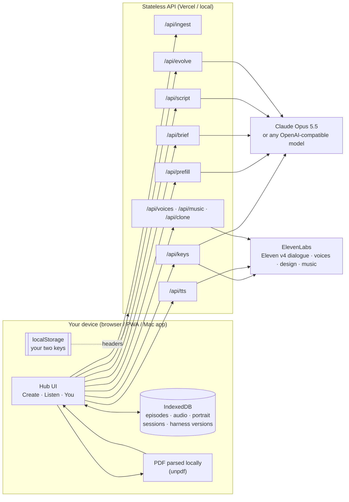
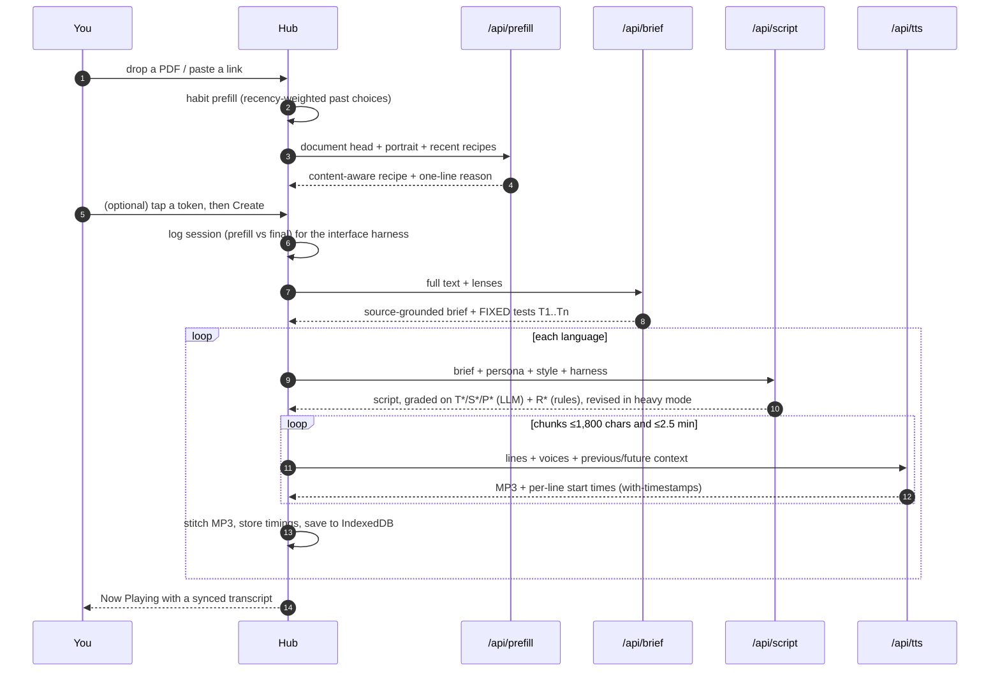
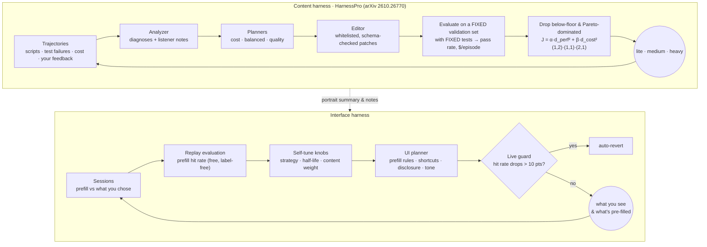
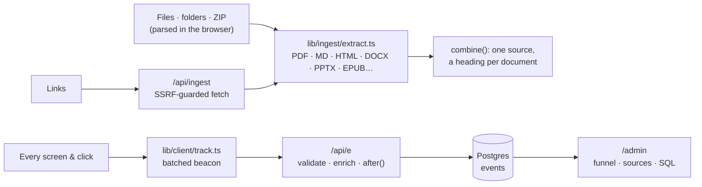

# Evocast architecture

Evocast is one Next.js codebase delivered three ways — web (Vercel), installable PWA, and a macOS app that runs the same server locally. All state lives on the device; the server is stateless and only forwards your own keys to the providers you chose.

## System

## One episode

## Two-layer recursive self-improvement

## What the content harness can change

| Knob | Range | Evolvable |
|---|---|---|
| `brief.rules`, `brief.maxFindings` | ≤14 rules, 3–10 | full scope only |
| `script.rules`, `script.structure` | ≤18 rules, 3–10 sections | ✓ |
| `script.hookLines`, `maxTurnChars.{zh,en}`, `reactionsPerMinute`, `audioTags` | bounded | ✓ |
| `script.charsPerMinute.{zh,en}` | 150–400 / 500–1200 | ✓ (calibrates length → TTS cost) |
| `pipeline.briefEffort`, `scriptEffort`, `grade`, `revise`, `maxRevisions` | enums / 0–2 | ✓ |
| `pipeline.ttsModel` | — | ✗ (text tests can't hear audio quality) |

## Tests per episode

| ID | Kind | Checked by |
|---|---|---|
| `T1..Tn` | coverage / accuracy / forbidden, synthesized once per document and frozen | LLM grader, per test |
| `S1, S2` | hook in the opening; no claim absent from the brief | LLM grader |
| `P1..P3` | persona-specific (e.g. executives: bottom line in the first 20%, exactly 3 takeaways) | LLM grader |
| `R1..R6` | length ±25%, turn length, speaker balance, filler budget, legal audio tags, written for the ear | deterministic code |

## Platform constraints that shaped the design

| Constraint | Design |
|---|---|
| Vercel: ≤300 s per function on every plan (Hobby's maximum), ≤4.5 MB bodies | PDFs parsed in the browser; TTS chunked to ≤2.5 min of audio; evolution orchestrated step-by-step from the client |
| Text-to-Dialogue: ≤2,000 chars / request | chunks ≤1,800 chars; `previous_text`/`future_text` across chunks |
| Mandarin ≈ 4 chars/s | Chinese chunks ≈ 625 chars (keeps responses under 4.5 MB) |
| Mac app needs the API locally | Electron `utilityProcess` runs the Next standalone server on a fixed port (stable IndexedDB origin) |

## Sources and analytics

- **Ingest** is one isomorphic module: the browser uses it for dropped files (no upload, no size limit), the server for links. Archives expand; several documents are combined under a water‑filled character budget that stays below Vercel's 4.5 MB request limit.
- **Analytics** is one append‑only `events` table (BRIN on time, btrees on name and visitor), created on first write. The collector answers `204` immediately and writes with `after()`. Every dashboard number is a plain SQL query, so anything on the dashboard can be re‑derived in the read‑only SQL console. A daily cron purges raw events older than `ANALYTICS_RETENTION_DAYS`.
- **Free trial**: a visitor without keys sends `x-llm-provider: hosted`. `lib/server/keys.ts` points the Anthropic SDK at Vercel AI Gateway (`anthropic/claude-opus-5.5`) with the request's OIDC token, and `/api/tts` voices each line through the gateway's ElevenLabs speech models, in parallel, so line starts stay exact. A `Meter` (`lib/server/trial.ts`) admits every call against today's per‑visitor and site caps and records its real cost in `trial_usage`; the visitor is a salted hash of the client address that changes daily. The admin reads the same table plus the live gateway balance.
- **Admin** runs on its own host when `ADMIN_HOST` is set (`proxy.ts` maps it to `/admin` and hides `/admin` elsewhere), behind `ADMIN_PASSWORD` and a signed HttpOnly cookie.
