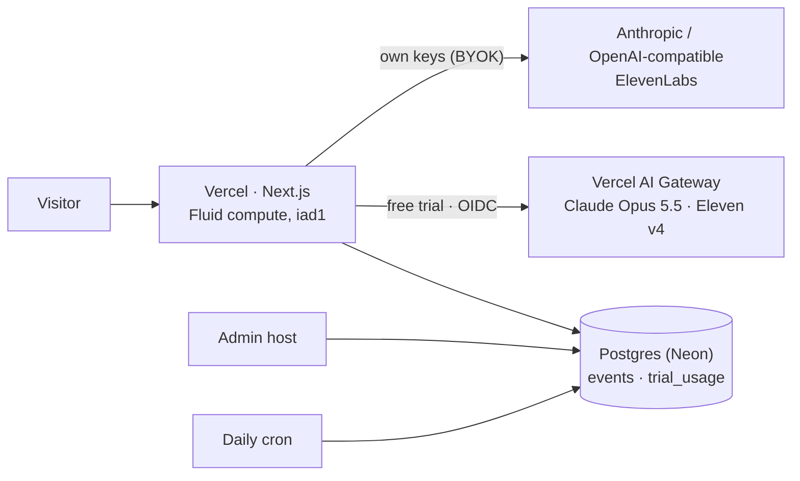

# Operating Evocast in public

What it takes to run Evocast for everyone: the parts, what each one costs, where the limits are, and what to do when one is reached. The official deployment, [evocast.vercel.app](https://evocast.vercel.app), runs exactly this setup. Figures were measured or checked on 2026‑10‑29.

[简体中文](OPERATIONS.zh-CN.md)

## The parts



| Part | Needed for | Without it |
|---|---|---|
| Vercel project | everything | — |
| Postgres (`DATABASE_URL`) | analytics, admin, trial metering | nothing is recorded; no trial (the welcome screen offers the offline demo) |
| AI Gateway (OIDC on Vercel, or `AI_GATEWAY_API_KEY`) | the free trial | visitors bring their own keys |
| `ADMIN_PASSWORD` (12+ chars), `ADMIN_HOST` | the admin console | no admin |
| `CRON_SECRET` | daily retention purge; also salts the trial's visitor hash | old rows are kept |

All variables are listed in [`.env.example`](../.env.example).

## Vercel

- **Any plan works technically.** Every function stays within 300 s, the maximum on Hobby; each generation stage measured 60–70 s. Hobby is for personal, non‑commercial use under Vercel's terms; the official deployment runs on Pro.
- **Cost is mostly waiting.** On Fluid compute, functions are billed for active CPU and provisioned memory. Time spent waiting on a model or voice call doesn't count as CPU, and that waiting is most of what Evocast's functions do.
- **4.5 MB request bodies.** Files are parsed in the browser, and combined sources are capped at 900k characters, so requests stay below this limit.
- **One region.** Functions run in `iad1`, the same region as the database.
- **Abuse.** Trial spend is capped whatever happens, and the Firewall rate limits below stop floods from any one address. Someone rotating IP addresses could still use up the site's daily trial allowance and close the trial for everyone until midnight UTC; if trial traffic starts to look automated, BotID is the next layer.
- **Mainland China.** `*.vercel.app` is often unreachable from mainland China. Serve Chinese visitors from a custom domain.

### Rate limits

The official deployment runs three Vercel Firewall rules. Each counts requests per IP over a fixed window and answers `429` past the limit; the app then says "Too many requests in a short time. Wait a minute and try again."

| Rule | Matches | Limit |
|---|---|---|
| Work routes per IP | `POST` to `/api/brief`, `script`, `tts`, `prefill`, `evolve`, `music`, `ingest`, `voices`, `clone` | 60 a minute; one person generating peaks at about 15 |
| Analytics collector per IP | `POST /api/e` | 120 a minute; the client sends a batch at most every 4 s |
| Admin login per IP | `POST /api/admin/login` | 10 per 10 minutes, on top of the app's own throttle |

To set up the first rule on your own project (Hobby allows one rate‑limit rule; Pro allows 40):

```bash
vercel firewall rules add "Work routes per IP" \
  --condition '{"type":"method","op":"eq","value":"POST"}' \
  --condition '{"type":"path","op":"inc","value":["/api/brief","/api/script","/api/tts","/api/prefill","/api/evolve","/api/music","/api/ingest","/api/voices","/api/clone"]}' \
  --action rate_limit --rate-limit-window 60 --rate-limit-requests 60 --rate-limit-keys ip --yes
vercel firewall publish --yes
```

Counters are kept per region. The first million allowed requests a month are included; these rules see only generation, event and sign‑in requests, so the volume stays small.

## Compute: Vercel AI Gateway

The free trial needs no provider keys. Requests carry the deployment's OIDC token and are billed to the team's prepaid AI Gateway credits.

| Model (Gateway id) | List price |
|---|---|
| `anthropic/claude-opus-5.5` | $4 in / $20 out per million tokens |
| `elevenlabs/eleven-v4`, `eleven-v3`, `eleven-multilingual-v2` | $0.04 per 1,000 characters |
| `elevenlabs/eleven-v4-turbo`, `eleven-flash-v2.5` | $0.02 per 1,000 characters |
| `elevenlabs/music-v2.5` (intro sting) | $0.00125 per second |

**Measured in production**, for one 3‑minute episode (medium harness, about 2 minutes to generate):

| | Model | Voice | Total |
|---|---|---|---|
| Chinese | ≈ $0.26 | ≈ $0.035 | ≈ $0.30 |
| English | ≈ $0.30 | ≈ $0.11 | ≈ $0.42 |

Model cost is mostly reading the source, and trial sources are cut at 100k characters. Voice cost grows with length: about $0.18 for 5 English minutes.

**Longer episodes** (8, 15, 30 minutes) are written and voiced chapter by chapter, and play from chapter 1. At list prices (estimated, not yet measured): reading the source once is about $0.25, then each 8 minutes adds about $0.15–0.20 of model cost; voice is about $0.01 a minute in Chinese and $0.033 in English. A 30-minute Chinese episode comes to about $1.10 and an English one to about $1.70, which is more than the default $1.50 a visitor gets per day, so the trial doesn't offer it (own keys do). Raise `TRIAL_VISITOR_USD` to offer it. Another length or language of the same source doesn't read it again (the brief is cached in the browser).

**A model per step** (v0.5): reading stays on Claude Opus 5.5, chapters are written by Sonnet 5.5, and the cold open, checks, prefill, atlas and answers run on Haiku 5.5, with the brief, plan and source cached across calls. Measured on the trial on 2026‑10‑30 with three arXiv papers, 8 minutes in Chinese: model cost $0.21–0.33 (it was about $0.56), voice about $0.08 at Gateway prices, first sound after 4.1–4.3 s, 15–16 of 17 checks passed. Reading the source (Opus, about 55–65 s and about $0.15–0.20) is now most of the model cost and most of the wait, so a 15-minute episode costs little more than an 8-minute one.

**Cold open and questions**: the cold open is one Haiku call on the first 8,000 characters (about $0.0005) voiced with Eleven v4 Turbo; a question is one Scribe transcription (about $0.002 a minute of speech), one Haiku call over the source, cached after the first question (about $0.0003–0.0006), and a few lines of v4 Turbo. Library voices can take 15–25 s on their first request through the Gateway; after that, a line takes 2–5 s.

**The research atlas** on You costs one small model call each time the library changes (titles, one-liners and glossary terms of up to 120 sources; a few cents), and is the one `/api/evolve` action the trial may run.

**Progress streams**: with `accept: application/x-ndjson`, `/api/brief`, `/api/script` and `/api/ask` stream `{"p": characters written}` while the model writes, `{"title"}` and `{"line"}` events as the cold open or an answer is written, then `{"ok": result}` or `{"error", "code", "status"}`. A live episode adds one cold-open call and one voice request per opening line; a question adds `/api/listen`, `/api/ask` and a few voice requests. Put `/api/ask` and `/api/listen` under the same per-IP rate rule as the other work routes.

**Spend control**, in three layers:

1. **Per visitor.** `TRIAL_VISITOR_USD` (default $1.50 a day) is checked before every call. A visitor is a salted hash of the client address that changes daily; the address itself is never stored.
2. **Whole site.** `TRIAL_DAILY_USD` (default $5 a day) works out to roughly 12–19 trial episodes a day.
3. **Gateway project budget.** Set it slightly above the site cap, refreshing daily (the official deployment uses $6), as a backstop in case metering is ever wrong. It applies only to this project's OIDC requests. When it is spent, the Gateway answers `402`, and visitors see the same "today's trial is full" message.

Local runs with a token from `vercel env pull` spend the same project budget. Recapturing the README's screenshots, for example, took about $5, including one evolution run. Do that kind of work early in the UTC day, or raise the budget for it.

Credits are prepaid. At a full $5 site cap, the trial costs about $150 a month. Turn on Gateway **auto top‑up**, or the trial stops when the balance does. The admin's **Trial compute** card shows today's spend against the cap and the live balance.

**Speech through the Gateway.**

- The Gateway's speech endpoint takes one voice per request, so each line is voiced on its own: four lines at a time, with exact line timings.
- A line that is only a tag such as `[laughs]` becomes a 0.4 s pause, because the Gateway rejects it.
- Transient `408/409/425/429/5xx` answers are retried twice, and the browser retries a failed chunk once.
- Text‑to‑speech on the Gateway is in beta.

## ElevenLabs

| | Free trial | Own key (BYOK) |
|---|---|---|
| Account needed | none: the Gateway's ElevenLabs credentials | the visitor's |
| Model | Eleven v4, one line per request | newest dialogue model the key has (Eleven v4 today), Text‑to‑Dialogue with timestamps |
| Price | Gateway: $0.04 / 1k chars | the visitor's plan; pay‑as‑you‑go API list price $0.08 / 1k chars |
| Changing voices (recommendations, Voice Library, Voice Design, cloning) | needs an own key | ✓ |

- **Default voices are Voice Library voices.** They work on the trial and on paid plans. A free plan can't use library voices through the API (ElevenLabs answers `402 paid_plan_required`), so each seat defaults to the closest voice in the account; an account with no voices (new accounts since March 2026 have none) gets one click to design both hosts with Voice Design, which works on every plan.
- **Library voices can be withdrawn by their creators.** A run that hits `voice_not_found` switches that seat to its top pick (on the trial, a vetted official voice from `SHELF` in `lib/tts/voices.ts`), saves it for that visitor and says so in one line. Swap the default id in `lib/harness/styles.ts` so new visitors get a working voice too.
- **Checking the defaults**: `npm run check:voices` makes every default and shelf voice say one word (about 50 characters in all, through the Gateway with `vercel env pull`'s token, or with `ELEVENLABS_API_KEY` on a paid plan). The weekly *Voices* workflow runs it once the repository has an `AI_GATEWAY_API_KEY` or `ELEVENLABS_API_KEY` secret; without one it skips.
- **Commercial use** follows the visitor's ElevenLabs plan for own keys, and Vercel's AI Product Terms plus the provider's terms for the trial.

## Database: Neon

The Neon Free plan includes 1 GB of storage, 100 CU‑hours a month and 5 GB of egress. The database sleeps after 5 minutes idle.

- **Compute is the limit that bites.** Steady all‑day traffic keeps the database awake: about 180 CU‑hours a month at the smallest size, 0.25 CU. Past 100 CU‑hours, Neon suspends compute until the next period. While suspended:
  - analytics stops;
  - the trial reports itself unavailable, so the welcome screen falls back to the demo.
- **Before launch traffic, move to Neon Launch.** It is pay‑as‑you‑go at $0.106 per CU‑hour, with no minimum.
- **Storage isn't the concern.** A visitor is a few kilobytes of events, so 1 GB holds on the order of 100k visitors. Raw rows are purged after `ANALYTICS_RETENTION_DAYS` (default 400).

## Admin and data quality

- The admin runs on its own host (`ADMIN_HOST`), behind `ADMIN_PASSWORD`. Changing the password signs every session out.
- Every number on the dashboard is SQL over `events` and `trial_usage`, so anything can be re‑derived in the read‑only console.
- Keep your own devices out of the numbers: Settings → *Share anonymous usage* → off. Do Not Track, Global Privacy Control and the Mac app send nothing.

## Runbook

| Symptom | Check | Fix |
|---|---|---|
| "Today's free trial is full" early in the day | Admin → Trial compute | raise `TRIAL_DAILY_USD` and the Gateway project budget; add a Firewall rule if traffic looks automated |
| Trial unavailable everywhere | `GET /api/trial` | database reachable? Neon compute suspended? `TRIAL=off`? |
| `402` in logs | Gateway → Budgets, credit balance | top up, enable auto top‑up, or raise the budget |
| Voice step fails | Admin → Generation → Failures; Vercel logs for `/api/tts`; `npm run check:voices` | transient errors retry on their own; a withdrawn voice is replaced per visitor automatically, so swap its id in `lib/harness/styles.ts` for everyone |
| Analytics stopped | Neon console usage | upgrade from Free, or wait for the next period |
| Real visitors see "Too many requests" | Vercel → Firewall, traffic for the rule | many people share one address (an office, a campus): raise the limit with `vercel firewall rules edit "Work routes per IP" --rate-limit-requests 120 --yes`, then `vercel firewall publish --yes` |
| Admin locked out | — | set a new `ADMIN_PASSWORD` and redeploy |

## Before announcing

- [ ] Repository public, with private vulnerability reporting on (SECURITY.md points there)
- [ ] Custom domain, for mainland China
- [ ] Gateway auto top‑up, and caps sized to the launch
- [ ] Neon Launch plan
- [ ] Firewall rate limits (see [Rate limits](#rate-limits)); BotID if trial traffic looks automated
- [ ] Social preview uploaded (GitHub → Settings → Social preview: `docs/assets/social-preview.jpg`)
