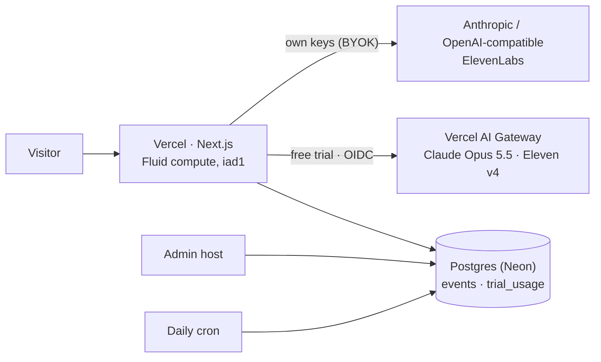

# Operating Evocast in public

What it takes to run Evocast for everyone: the parts, what each one costs, where the limits are, and what to do when one is reached. The official deployment, [evocast.vercel.app](https://evocast.vercel.app), runs exactly this setup. Figures were measured or checked on 2026‑10‑29.

[简体中文](OPERATIONS.zh-CN.md)

## The parts

| Part | Needed for | Without it |
|---|---|---|
| Vercel project | everything | — |
| Postgres (`DATABASE_URL`) | analytics, admin, trial metering | nothing is recorded; no trial (the welcome screen offers the offline demo) |
| AI Gateway (OIDC on Vercel, or `AI_GATEWAY_API_KEY`) | the free trial | visitors bring their own keys |
| `ADMIN_PASSWORD` (12+ chars), `ADMIN_HOST` | the admin console | no admin |
| `CRON_SECRET` | daily retention purge; also salts the trial's visitor hash | old rows are kept |

All variables are listed in [`.env.example`](../.env.example).

## Vercel

- **Any plan works technically.** Every function stays within 300 s, the maximum on Hobby; each generation stage measured 60–70 s. Hobby is for personal, non‑commercial use under Vercel's terms; the official deployment runs on Pro.
- **Cost is mostly waiting.** On Fluid compute, functions are billed for active CPU and provisioned memory. Time spent waiting on a model or voice call doesn't count as CPU, and that waiting is most of what Evocast's functions do.
- **4.5 MB request bodies.** Files are parsed in the browser, and combined sources are capped at 900k characters, so requests stay below this limit.
- **One region.** Functions run in `iad1`, the same region as the database.
- **Abuse.** Trial spend is capped whatever happens. Still, someone rotating IP addresses could use up the site's daily trial allowance and close the trial for everyone until midnight UTC. Before announcing widely, add a Vercel Firewall rate‑limit rule (or BotID) on `/api/brief`, `/api/script`, `/api/tts`, `/api/prefill`, `/api/evolve` and `/api/music`.
- **Mainland China.** `*.vercel.app` is often unreachable from mainland China. Serve Chinese visitors from a custom domain.

## Compute: Vercel AI Gateway

The free trial needs no provider keys. Requests carry the deployment's OIDC token and are billed to the team's prepaid AI Gateway credits.

| Model (Gateway id) | List price |
|---|---|
| `anthropic/claude-opus-5.5` | $4 in / $20 out per million tokens |
| `elevenlabs/eleven-v4`, `eleven-v3`, `eleven-multilingual-v2` | $0.04 per 1,000 characters |
| `elevenlabs/eleven-v4-turbo`, `eleven-flash-v2.5` | $0.02 per 1,000 characters |
| `elevenlabs/music-v2.5` (intro sting) | $0.00125 per second |

**Measured in production**, for one 3‑minute episode (medium harness, about 2 minutes to generate):

| | Model | Voice | Total |
|---|---|---|---|
| Chinese | ≈ $0.26 | ≈ $0.035 | ≈ $0.30 |
| English | ≈ $0.30 | ≈ $0.11 | ≈ $0.42 |

Model cost is mostly reading the source, and trial sources are cut at 100k characters. Voice cost grows with length: about $0.18 for 5 English minutes.

**Spend control**, in three layers:

1. **Per visitor.** `TRIAL_VISITOR_USD` (default $1.50 a day) is checked before every call. A visitor is a salted hash of the client address that changes daily; the address itself is never stored.
2. **Whole site.** `TRIAL_DAILY_USD` (default $5 a day) works out to roughly 12–19 trial episodes a day.
3. **Gateway project budget.** Set it slightly above the site cap, refreshing daily (the official deployment uses $6), as a backstop in case metering is ever wrong. It applies only to this project's OIDC requests. When it is spent, the Gateway answers `402`, and visitors see the same "today's trial is full" message.

Credits are prepaid. At a full $5 site cap, the trial costs about $150 a month. Turn on Gateway **auto top‑up**, or the trial stops when the balance does. The admin's **Trial compute** card shows today's spend against the cap and the live balance.

**Speech through the Gateway.**

- The Gateway's speech endpoint takes one voice per request, so each line is voiced on its own: four lines at a time, with exact line timings.
- A line that is only a tag such as `[laughs]` becomes a 0.4 s pause, because the Gateway rejects it.
- Transient `408/409/425/429/5xx` answers are retried twice, and the browser retries a failed chunk once.
- Text‑to‑speech on the Gateway is in beta.

## ElevenLabs

| | Free trial | Own key (BYOK) |
|---|---|---|
| Account needed | none: the Gateway's ElevenLabs credentials | the visitor's |
| Model | Eleven v4, one line per request | newest dialogue model the key has (Eleven v4 today), Text‑to‑Dialogue with timestamps |
| Price | Gateway: $0.04 / 1k chars | the visitor's plan; pay‑as‑you‑go API list price $0.08 / 1k chars |
| Changing voices (recommendations, Voice Library, Voice Design, cloning) | needs an own key | ✓ |

- **Default voices are Voice Library voices.** They work on the trial. With an own key, using library voices through the API needs a paid ElevenLabs plan; on a free plan, pick your own voices in Settings → Voices.
- **Library voices can be withdrawn by their creators.** If a default seat starts failing, swap its id in `lib/harness/styles.ts`.
- **Commercial use** follows the visitor's ElevenLabs plan for own keys, and Vercel's AI Product Terms plus the provider's terms for the trial.

## Database: Neon

The Neon Free plan includes 1 GB of storage, 100 CU‑hours a month and 5 GB of egress. The database sleeps after 5 minutes idle.

- **Compute is the limit that bites.** Steady all‑day traffic keeps the database awake: about 180 CU‑hours a month at the smallest size, 0.25 CU. Past 100 CU‑hours, Neon suspends compute until the next period. While suspended:
  - analytics stops;
  - the trial reports itself unavailable, so the welcome screen falls back to the demo.
- **Before launch traffic, move to Neon Launch.** It is pay‑as‑you‑go at $0.106 per CU‑hour, with no minimum.
- **Storage isn't the concern.** A visitor is a few kilobytes of events, so 1 GB holds on the order of 100k visitors. Raw rows are purged after `ANALYTICS_RETENTION_DAYS` (default 400).

## Admin and data quality

- The admin runs on its own host (`ADMIN_HOST`), behind `ADMIN_PASSWORD`. Changing the password signs every session out.
- Every number on the dashboard is SQL over `events` and `trial_usage`, so anything can be re‑derived in the read‑only console.
- Keep your own devices out of the numbers: Settings → *Share anonymous usage* → off. Do Not Track, Global Privacy Control and the Mac app send nothing.

## Runbook

| Symptom | Check | Fix |
|---|---|---|
| "Today's free trial is full" early in the day | Admin → Trial compute | raise `TRIAL_DAILY_USD` and the Gateway project budget; add a Firewall rule if traffic looks automated |
| Trial unavailable everywhere | `GET /api/trial` | database reachable? Neon compute suspended? `TRIAL=off`? |
| `402` in logs | Gateway → Budgets, credit balance | top up, enable auto top‑up, or raise the budget |
| Voice step fails | Admin → Generation → Failures; Vercel logs for `/api/tts` | transient errors retry on their own; a voice id that keeps failing was withdrawn, so swap it |
| Analytics stopped | Neon console usage | upgrade from Free, or wait for the next period |
| Admin locked out | — | set a new `ADMIN_PASSWORD` and redeploy |

## Before announcing

- [ ] Repository public, with private vulnerability reporting on (SECURITY.md points there)
- [ ] Custom domain, for mainland China
- [ ] Gateway auto top‑up, and caps sized to the launch
- [ ] Neon Launch plan
- [ ] Firewall rate‑limit rule or BotID on the generation routes
- [ ] Social preview uploaded (GitHub → Settings → Social preview: `docs/assets/social-preview.jpg`)
