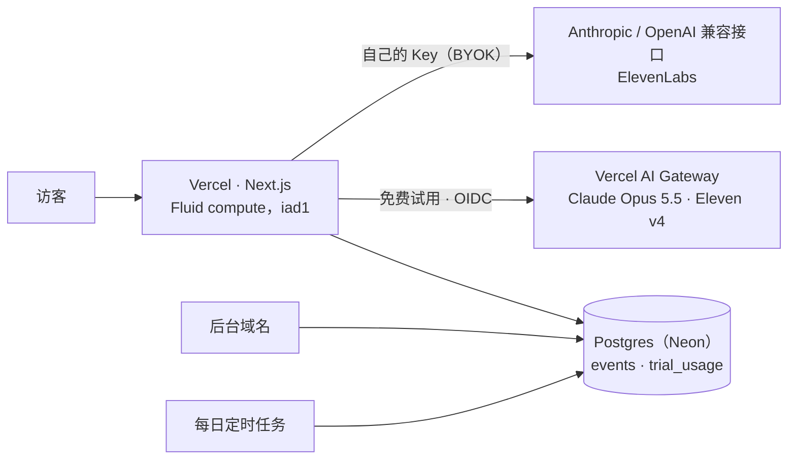

# 公开运营 Evocast

面向所有人开放 Evocast 需要哪些部件、各自花多少钱、上限在哪里、碰到上限怎么办。官方部署 [evocast.vercel.app](https://evocast.vercel.app) 就是按这份配置运行的。文中数字测于或核实于 2026‑10‑29。

[English](OPERATIONS.md)

## 部件



| 部件 | 用途 | 缺了会怎样 |
|---|---|---|
| Vercel 项目 | 全部 | — |
| Postgres（`DATABASE_URL`） | 埋点、后台、试用计量 | 什么都不记录；没有试用，欢迎页改为离线演示 |
| AI Gateway（Vercel 上用 OIDC，其他地方用 `AI_GATEWAY_API_KEY`） | 免费试用 | 访客只能填自己的 Key |
| `ADMIN_PASSWORD`（至少 12 位）、`ADMIN_HOST` | 管理后台 | 没有后台 |
| `CRON_SECRET` | 每日清理过期数据；同时作为试用访客哈希的盐 | 旧数据不清理 |

全部变量见 [`.env.example`](../.env.example)。

## Vercel

- **技术上任何套餐都能跑。** 所有函数都不超过 300 秒，这是免费 Hobby 套餐的上限；实测每个生成阶段 60–70 秒。按 Vercel 条款，Hobby 只限个人、非商业使用；官方部署用的是 Pro。
- **费用主要花在等待上。** Fluid compute 按实际 CPU 时间和内存时间计费，等大模型、等语音的时间不算 CPU，而 Evocast 的函数大部分时间都在等。
- **请求体上限 4.5 MB。** 文件在浏览器里解析，合并后的材料最多 90 万字，所以不会超过这个上限。
- **单一区域。** 函数在 `iad1`，和数据库同区。
- **防刷。** 无论如何，试用花费都有上限；下面的 Firewall 限流规则能挡住来自单个地址的大量请求。但有人换着 IP 刷，仍然可以把全站当天的试用额度用光，让所有人在 UTC 零点前都用不了试用。如果试用流量看起来像机器刷的，下一步是启用 BotID。
- **中国大陆。** `*.vercel.app` 在中国大陆经常打不开，面向中文用户需要绑定自己的域名。

### 限流

官方部署配了三条 Vercel Firewall 规则，都按 IP 在固定时间窗口内计数，超过上限返回 `429`，应用里显示「请求太频繁了，等一分钟再试。」

| 规则 | 匹配 | 上限 |
|---|---|---|
| Work routes per IP | 对 `/api/brief`、`script`、`tts`、`prefill`、`evolve`、`music`、`ingest`、`voices`、`clone` 的 `POST` | 每分钟 60 次；一个人生成节目时最多约 15 次 |
| Analytics collector per IP | `POST /api/e` | 每分钟 120 次；客户端最快每 4 秒发一批 |
| Admin login per IP | `POST /api/admin/login` | 每 10 分钟 10 次，在应用自身的限制之外再加一层 |

在自己的项目上配置第一条规则（Hobby 只能有一条限流规则，Pro 最多 40 条）：

```bash
vercel firewall rules add "Work routes per IP" \
  --condition '{"type":"method","op":"eq","value":"POST"}' \
  --condition '{"type":"path","op":"inc","value":["/api/brief","/api/script","/api/tts","/api/prefill","/api/evolve","/api/music","/api/ingest","/api/voices","/api/clone"]}' \
  --action rate_limit --rate-limit-window 60 --rate-limit-requests 60 --rate-limit-keys ip --yes
vercel firewall publish --yes
```

计数按区域分别进行。每月前 100 万次放行请求免费；这些规则只匹配生成、埋点和后台登录请求，量很小。

## 算力：Vercel AI Gateway

免费试用不需要任何服务商的 Key：请求带着部署自己的 OIDC 身份，费用从团队预付的 AI Gateway 额度里扣。

| 模型（Gateway 名称） | 官方价格 |
|---|---|
| `anthropic/claude-opus-5.5` | 输入每百万 token 4 美元，输出 20 美元 |
| `elevenlabs/eleven-v4`、`eleven-v3`、`eleven-multilingual-v2` | 每千字符 0.04 美元 |
| `elevenlabs/eleven-v4-turbo`、`eleven-flash-v2.5` | 每千字符 0.02 美元 |
| `elevenlabs/music-v2.5`（片头音乐） | 每秒 0.00125 美元 |

**生产环境实测**，一期 3 分钟节目（medium 档，生成约 2 分钟）：

| | 大模型 | 语音 | 合计 |
|---|---|---|---|
| 中文 | 约 0.26 美元 | 约 0.035 美元 | 约 0.30 美元 |
| 英文 | 约 0.30 美元 | 约 0.11 美元 | 约 0.42 美元 |

大模型的花费主要来自读材料，试用最多读前 10 万字。语音的花费随时长增加，英文 5 分钟约 0.18 美元。

**更长的节目**（8、15、30 分钟）按章节写和配音，第 1 章配好就开始播放。按官方价格估算（未实测）：读材料一次约 0.25 美元，之后每 8 分钟约增加 0.15–0.2 美元的大模型费用；语音中文每分钟约 0.01 美元，英文约 0.033 美元。一期 30 分钟的中文节目约 1.1 美元，英文约 1.7 美元，后者超过默认的每位访客每天 1.5 美元，所以试用下菜单里不会提供它（要自己的 Key）。想在试用里提供，就调高 `TRIAL_VISITOR_USD`。同一份材料再生成别的时长或语言，不会再读一遍（要点缓存在浏览器里）。

**每一步用合适的模型**（v0.5）：读原文仍用 Claude Opus 5.5，分章写稿用 Sonnet 5.5，冷开场、校验、预填、星图和问答用 Haiku 5.5，要点、章节规划和原文在多次调用之间走提示缓存。2026-10-30 在试用上用三篇 arXiv 论文实测（8 分钟中文）：大模型花费 0.21–0.33 美元（原来约 0.56），按 Gateway 价格语音约 0.08 美元，第一个声音在点击后 4.1–4.3 秒，17 项校验通过 15–16 项。现在大模型的花费和等待主要来自读原文（Opus，约 55–65 秒、0.15–0.2 美元），所以 15 分钟的节目只比 8 分钟贵一点。

**冷开场与提问**：冷开场是对前 8000 字的一次 Haiku 调用（约 0.0005 美元），用 Eleven v4 Turbo 配音；一次提问是一次 Scribe 听写（每分钟语音约 0.002 美元）、一次读全文的 Haiku 调用（第一次之后原文走缓存，约 0.0003–0.0006 美元），再加几句 v4 Turbo 配音。声音库里的声音第一次通过 Gateway 使用时可能要 15–25 秒，之后一句 2–5 秒。

**学术星图**（「你」页面）在节目库变化时调用一次大模型（最多 120 份材料的标题、一句话总结和术语表，几美分），这是 `/api/evolve` 里唯一允许免费试用调用的动作。

**进度流**：`/api/brief`、`/api/script` 和 `/api/ask` 在请求带 `accept: application/x-ndjson` 时，边写边返回 `{"p": 已写字符数}`，冷开场或回答写出时还会返回 `{"title"}` 和 `{"line"}`，最后是 `{"ok": 结果}` 或带错误码的 `{"error", "code", "status"}`。边听边做的节目多一次冷开场调用，开场每句一次配音请求；一次提问多出 `/api/listen`、`/api/ask` 和几次配音请求。把 `/api/ask` 和 `/api/listen` 加进其他工作路由同一条按 IP 限流的规则。

**花费控制，三层：**

1. **每位访客**：`TRIAL_VISITOR_USD`，默认每天 1.5 美元，每次调用前检查。访客用客户端地址的加盐哈希区分，每天更换，从不保存地址本身。
2. **全站**：`TRIAL_DAILY_USD`，默认每天 5 美元，大约够 12–19 期试用节目。
3. **Gateway 项目预算**：设得比全站上限略高、按天重置（官方部署设的是 6 美元），作为计量万一出错时的兜底。它只限制这个项目发出的 OIDC 请求。用完后 Gateway 返回 `402`，访客看到的是同样的「今天的试用名额已满」。

本地用 `vercel env pull` 拉到的 token 跑，花的是同一个项目预算。比如重拍 README 截图（含一轮进化）大约花 5 美元，这类工作最好放在 UTC 日初，或者临时调高预算。

额度是预付的。全站 5 美元的上限每天用满，一个月约 150 美元。建议打开 Gateway 的**自动充值**，否则余额用完试用就停了。后台的**试用算力**卡片会显示今天的花费、上限和实时余额。

**通过 Gateway 合成语音：**

- Gateway 的语音接口每次只接受一个声音，所以每句话单独合成，4 句并行，逐句时间点精确。
- 只有语气标签的一句（如 `[laughs]`）会被 Gateway 拒绝，所以改成 0.4 秒停顿。
- 偶发的 `408/409/425/429/5xx` 会自动重试两次，浏览器端每段失败再整体重试一次。
- Gateway 的文字转语音目前还是 beta。

## ElevenLabs

| | 免费试用 | 自己的 Key（BYOK） |
|---|---|---|
| 是否需要账号 | 不需要，用 Gateway 的 ElevenLabs 额度 | 访客自己的账号 |
| 模型 | Eleven v4，每句一次请求 | Key 可用的最新对话模型（目前是 Eleven v4），用带时间戳的多人对话接口 |
| 价格 | Gateway：每千字符 0.04 美元 | 访客自己的套餐；按量付费的 API 官方价格是每千字符 0.08 美元 |
| 换声音（推荐、声音库、声音设计、克隆） | 需要自己的 Key | ✓ |

- **默认声音来自 Voice Library。** 试用和付费套餐都能正常使用。免费套餐不能通过 API 使用声音库声音（ElevenLabs 返回 `402 paid_plan_required`），所以每个位置默认用账户里最接近的声音；账户里一个声音都没有时（2026 年 3 月之后注册的新账户没有默认声音），可以一键用 Voice Design 设计两位主播，所有套餐都能用。
- **声音库里的声音可能被作者下架。** 生成时遇到 `voice_not_found`，会把这个位置换成它的首选（试用下换成 `lib/tts/voices.ts` 里 `SHELF` 中核验过的官方声音），为这位访客保存下来，并用一行字说明。再到 `lib/harness/styles.ts` 里换掉默认 id，新访客也就能用了。
- **检查默认声音**：`npm run check:voices` 让每个默认声音和备选声音各说一个词（总共约 50 个字符；用 `vercel env pull` 拿到的 Gateway token，或者付费套餐的 `ELEVENLABS_API_KEY`）。仓库配置了 `AI_GATEWAY_API_KEY` 或 `ELEVENLABS_API_KEY` secret 后，每周的 *Voices* 工作流会自动跑；没有就跳过。
- **商用。** 用自己 Key 时取决于访客自己的 ElevenLabs 套餐；试用时适用 Vercel 的 AI 产品条款和服务商条款。

## 数据库：Neon

Neon 免费档包含 1 GB 存储、每月 100 CU 小时计算和 5 GB 出站流量，闲置 5 分钟会自动休眠。

- **真正会碰到的是计算时长。** 全天都有访问时，数据库一直醒着，按最小规格 0.25 CU 算，一个月约 180 CU 小时。超过 100 CU 小时后 Neon 会暂停计算，直到下个周期。暂停期间：
  - 埋点停止；
  - 试用显示不可用，欢迎页退回演示模式。
- **有正式流量之前，建议升级到 Neon Launch。** 它按量付费，每 CU 小时 0.106 美元，没有最低消费。
- **存储不是问题。** 一位访客的事件只有几 KB，1 GB 大约够 10 万量级的访客。原始数据保留 `ANALYTICS_RETENTION_DAYS` 天（默认 400）后自动清理。

## 后台与数据质量

- 后台在独立域名（`ADMIN_HOST`）上，用 `ADMIN_PASSWORD` 保护；改密码会让所有已登录的会话失效。
- 看板上每个数字都是对 `events` 和 `trial_usage` 的 SQL 查询，都可以在只读 SQL 控制台里自己复算。
- 不想让自己的设备混进统计：在「设置 → 分享匿名使用数据」里关掉。开了「请勿追踪」或 GPC 的浏览器、以及 Mac App 都不会发送数据。

## 处理手册

| 现象 | 看哪里 | 怎么办 |
|---|---|---|
| 一大早就提示「今天的试用名额已满」 | 后台 → 试用算力 | 提高 `TRIAL_DAILY_USD` 和 Gateway 项目预算；流量像是机器刷的，就加 Firewall 规则 |
| 所有人都看不到试用 | `GET /api/trial` | 数据库连得上吗？Neon 被暂停了吗？是否设置了 `TRIAL=off`？ |
| 日志里出现 `402` | Gateway → Budgets，以及额度余额 | 充值、开自动充值，或提高预算 |
| 配音失败 | 后台 → 生成 → 失败原因；Vercel 日志里的 `/api/tts`；`npm run check:voices` | 偶发错误会自动重试；被下架的声音会为每位访客自动替换，再到 `lib/harness/styles.ts` 里为所有人换掉它的 id |
| 埋点停了 | Neon 控制台的用量 | 从免费档升级，或等到下个周期 |
| 真实访客看到「请求太频繁了」 | Vercel → Firewall 里这条规则的流量 | 很多人共用一个出口地址（公司、校园）：用 `vercel firewall rules edit "Work routes per IP" --rate-limit-requests 120 --yes` 调高上限，再运行 `vercel firewall publish --yes` |
| 后台登录不了 | — | 设置新的 `ADMIN_PASSWORD` 并重新部署 |

## 公开推广前

- [ ] 仓库公开，并打开私密漏洞报告（SECURITY.md 指向那里）
- [ ] 绑定自己的域名，给中国大陆访客用
- [ ] 打开 Gateway 自动充值，按推广规模调好上限
- [ ] Neon 升级到 Launch
- [ ] Firewall 限流规则（见[限流](#限流)）；试用流量像机器刷的，再启用 BotID
- [ ] 上传社交预览图（GitHub → Settings → Social preview：`docs/assets/social-preview.jpg`）
