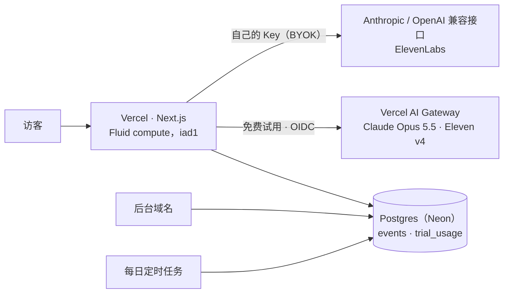

# 公开运营 Evocast

面向所有人开放 Evocast 需要哪些部件、各自花多少钱、上限在哪里、碰到上限怎么办。官方部署 [evocast.vercel.app](https://evocast.vercel.app) 就是按这份配置运行的。文中数字测于或核实于 2026‑10‑29。

[English](OPERATIONS.md)

## 部件

| 部件 | 用途 | 缺了会怎样 |
|---|---|---|
| Vercel 项目 | 全部 | — |
| Postgres（`DATABASE_URL`） | 埋点、后台、试用计量 | 什么都不记录；没有试用，欢迎页改为离线演示 |
| AI Gateway（Vercel 上用 OIDC，其他地方用 `AI_GATEWAY_API_KEY`） | 免费试用 | 访客只能填自己的 Key |
| `ADMIN_PASSWORD`（至少 12 位）、`ADMIN_HOST` | 管理后台 | 没有后台 |
| `CRON_SECRET` | 每日清理过期数据；同时作为试用访客哈希的盐 | 旧数据不清理 |

全部变量见 [`.env.example`](../.env.example)。

## Vercel

- **技术上任何套餐都能跑。** 所有函数都不超过 300 秒，这是免费 Hobby 套餐的上限；实测每个生成阶段 60–70 秒。按 Vercel 条款，Hobby 只限个人、非商业使用；官方部署用的是 Pro。
- **费用主要花在等待上。** Fluid compute 按实际 CPU 时间和内存时间计费，等大模型、等语音的时间不算 CPU，而 Evocast 的函数大部分时间都在等。
- **请求体上限 4.5 MB。** 文件在浏览器里解析，合并后的材料最多 90 万字，所以不会超过这个上限。
- **单一区域。** 函数在 `iad1`，和数据库同区。
- **防刷。** 无论如何，试用花费都有上限。但有人换着 IP 刷，可以把全站当天的试用额度用光，让所有人在 UTC 零点前都用不了试用。大规模推广前，建议给 `/api/brief`、`/api/script`、`/api/tts`、`/api/prefill`、`/api/evolve`、`/api/music` 加一条 Vercel Firewall 限流规则（或启用 BotID）。
- **中国大陆。** `*.vercel.app` 在中国大陆经常打不开，面向中文用户需要绑定自己的域名。

## 算力：Vercel AI Gateway

免费试用不需要任何服务商的 Key：请求带着部署自己的 OIDC 身份，费用从团队预付的 AI Gateway 额度里扣。

| 模型（Gateway 名称） | 官方价格 |
|---|---|
| `anthropic/claude-opus-5.5` | 输入每百万 token 4 美元，输出 20 美元 |
| `elevenlabs/eleven-v4`、`eleven-v3`、`eleven-multilingual-v2` | 每千字符 0.04 美元 |
| `elevenlabs/eleven-v4-turbo`、`eleven-flash-v2.5` | 每千字符 0.02 美元 |
| `elevenlabs/music-v2.5`（片头音乐） | 每秒 0.00125 美元 |

**生产环境实测**，一期 3 分钟节目（medium 档，生成约 2 分钟）：

| | 大模型 | 语音 | 合计 |
|---|---|---|---|
| 中文 | 约 0.26 美元 | 约 0.035 美元 | 约 0.30 美元 |
| 英文 | 约 0.30 美元 | 约 0.11 美元 | 约 0.42 美元 |

大模型的花费主要来自读材料，试用最多读前 10 万字。语音的花费随时长增加，英文 5 分钟约 0.18 美元。

**花费控制，三层：**

1. **每位访客**：`TRIAL_VISITOR_USD`，默认每天 1.5 美元，每次调用前检查。访客用客户端地址的加盐哈希区分，每天更换，从不保存地址本身。
2. **全站**：`TRIAL_DAILY_USD`，默认每天 5 美元，大约够 12–19 期试用节目。
3. **Gateway 项目预算**：设得比全站上限略高、按天重置（官方部署设的是 6 美元），作为计量万一出错时的兜底。它只限制这个项目发出的 OIDC 请求。用完后 Gateway 返回 `402`，访客看到的是同样的「今天的试用名额已满」。

额度是预付的。全站 5 美元的上限每天用满，一个月约 150 美元。建议打开 Gateway 的**自动充值**，否则余额用完试用就停了。后台的**试用算力**卡片会显示今天的花费、上限和实时余额。

**通过 Gateway 合成语音：**

- Gateway 的语音接口每次只接受一个声音，所以每句话单独合成，4 句并行，逐句时间点精确。
- 只有语气标签的一句（如 `[laughs]`）会被 Gateway 拒绝，所以改成 0.4 秒停顿。
- 偶发的 `408/409/425/429/5xx` 会自动重试两次，浏览器端每段失败再整体重试一次。
- Gateway 的文字转语音目前还是 beta。

## ElevenLabs

| | 免费试用 | 自己的 Key（BYOK） |
|---|---|---|
| 是否需要账号 | 不需要，用 Gateway 的 ElevenLabs 额度 | 访客自己的账号 |
| 模型 | Eleven v4，每句一次请求 | Key 可用的最新对话模型（目前是 Eleven v4），用带时间戳的多人对话接口 |
| 价格 | Gateway：每千字符 0.04 美元 | 访客自己的套餐；按量付费的 API 官方价格是每千字符 0.08 美元 |
| 换声音（推荐、声音库、声音设计、克隆） | 需要自己的 Key | ✓ |

- **默认声音来自 Voice Library。** 试用下可以正常使用。用自己的 Key 时，通过 API 使用声音库的声音需要 ElevenLabs 付费套餐；免费套餐的用户请在「设置 → 声音」里换成自己的声音。
- **声音库里的声音可能被作者下架。** 如果某个默认位置开始持续失败，在 `lib/harness/styles.ts` 里换掉它的 id。
- **商用。** 用自己 Key 时取决于访客自己的 ElevenLabs 套餐；试用时适用 Vercel 的 AI 产品条款和服务商条款。

## 数据库：Neon

Neon 免费档包含 1 GB 存储、每月 100 CU 小时计算和 5 GB 出站流量，闲置 5 分钟会自动休眠。

- **真正会碰到的是计算时长。** 全天都有访问时，数据库一直醒着，按最小规格 0.25 CU 算，一个月约 180 CU 小时。超过 100 CU 小时后 Neon 会暂停计算，直到下个周期。暂停期间：
  - 埋点停止；
  - 试用显示不可用，欢迎页退回演示模式。
- **有正式流量之前，建议升级到 Neon Launch。** 它按量付费，每 CU 小时 0.106 美元，没有最低消费。
- **存储不是问题。** 一位访客的事件只有几 KB，1 GB 大约够 10 万量级的访客。原始数据保留 `ANALYTICS_RETENTION_DAYS` 天（默认 400）后自动清理。

## 后台与数据质量

- 后台在独立域名（`ADMIN_HOST`）上，用 `ADMIN_PASSWORD` 保护；改密码会让所有已登录的会话失效。
- 看板上每个数字都是对 `events` 和 `trial_usage` 的 SQL 查询，都可以在只读 SQL 控制台里自己复算。
- 不想让自己的设备混进统计：在「设置 → 分享匿名使用数据」里关掉。开了「请勿追踪」或 GPC 的浏览器、以及 Mac App 都不会发送数据。

## 处理手册

| 现象 | 看哪里 | 怎么办 |
|---|---|---|
| 一大早就提示「今天的试用名额已满」 | 后台 → 试用算力 | 提高 `TRIAL_DAILY_USD` 和 Gateway 项目预算；流量像是机器刷的，就加 Firewall 规则 |
| 所有人都看不到试用 | `GET /api/trial` | 数据库连得上吗？Neon 被暂停了吗？是否设置了 `TRIAL=off`？ |
| 日志里出现 `402` | Gateway → Budgets，以及额度余额 | 充值、开自动充值，或提高预算 |
| 配音失败 | 后台 → 生成 → 失败原因；Vercel 日志里的 `/api/tts` | 偶发错误会自动重试；某个声音 id 持续失败，说明已被下架，换掉它 |
| 埋点停了 | Neon 控制台的用量 | 从免费档升级，或等到下个周期 |
| 后台登录不了 | — | 设置新的 `ADMIN_PASSWORD` 并重新部署 |

## 公开推广前

- [ ] 仓库公开，并打开私密漏洞报告（SECURITY.md 指向那里）
- [ ] 绑定自己的域名，给中国大陆访客用
- [ ] 打开 Gateway 自动充值，按推广规模调好上限
- [ ] Neon 升级到 Launch
- [ ] 给生成相关接口加 Firewall 限流规则或 BotID
- [ ] 上传社交预览图（GitHub → Settings → Social preview：`docs/assets/social-preview.jpg`）
